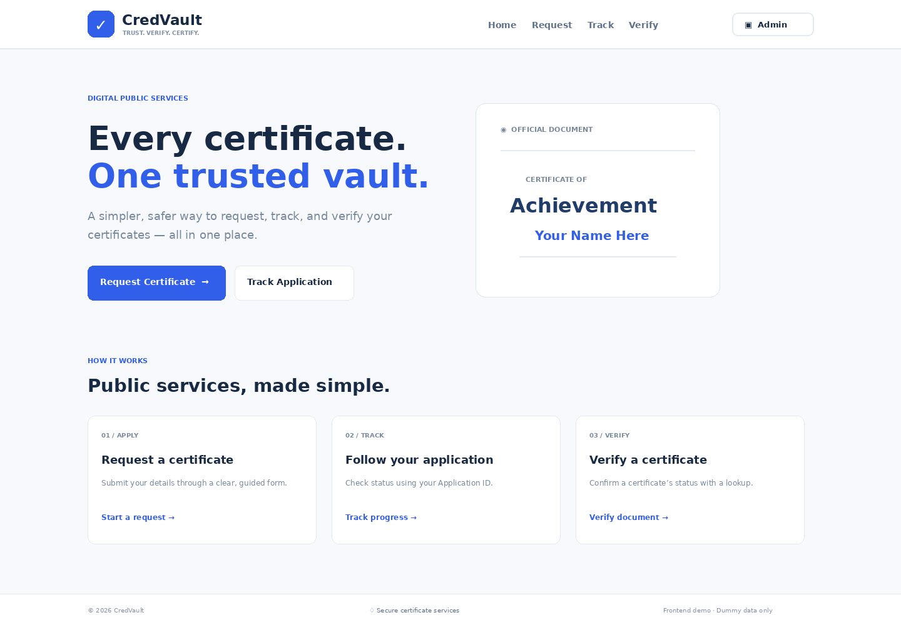
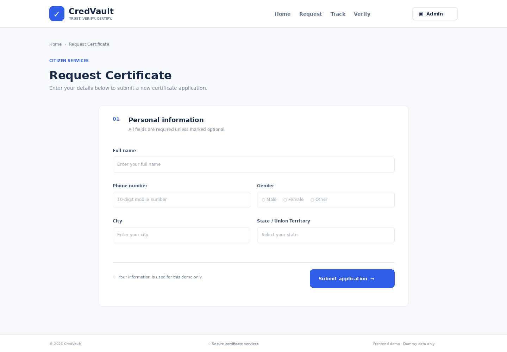
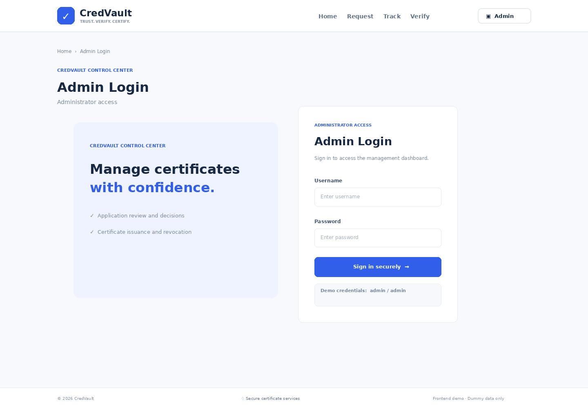

# CredVault — ELEVATE SDE Task 2

**Certificate Issuing & Verification Platform** — responsive frontend prototype built with React, Vite, React Router, and CSS. This task intentionally uses dummy data only; no backend or database is required.

## Pages implemented

| Route | Page | Features |
|---|---|---|
| `/` | Home | CredVault title/tagline, navigation to request, track, and verify |
| `/request` | Request Certificate | Name, 10-digit phone, gender radio, city, all Indian States/UTs, validation, success message and generated Application ID |
| `/track` | Track Application | Application ID lookup, name/status/submission date and timeline, not-found error |
| `/verify` | Verify Certificate | Certificate ID lookup, holder/phone/issued date/status, valid/revoked/not-found states |
| `/admin/login` | Admin Login | Demo login (`admin` / `admin`) |
| `/admin/applications` | Applications | Search/filter table, Issue and Reject actions, summary counts |
| `/admin/certificates` | Certificates | Search/filter table, Revoke action, summary counts |

## Tech stack

- React 18 + Vite
- React Router DOM
- Lucide React icons
- CSS responsive layout (mobile, tablet, desktop)
- Browser `localStorage` for demo application/certificate data; `sessionStorage` for demo admin login

## Run locally

Requires Node.js 18+ and npm.

```bash
npm install
npm run dev
```

Open the local URL printed by Vite (usually `http://localhost:5173`).

Create a production build:

```bash
npm run build
npm run preview
```

## Demo credentials

- **Username:** `admin`
- **Password:** `admin`

## Demo lookup IDs

- Applications: `APP-0001`, `APP-0002`, `APP-0003`, `APP-0004`
- Certificates: `CERT-2026-001`, `CERT-2026-002`, `CERT-2026-003`

New application requests are stored in your browser and get the next available `APP-####` ID. In the admin Applications page, **Issue** approves the application and creates a demo certificate record; **Reject** changes its status. Admins can revoke valid certificates. The public Verify page shows revoked records as revoked.

> This is a frontend-only prototype. Browser storage is not a secure database, and the demo login is not real authentication. Do not enter real personal data.

## Page previews

The images below are visual page previews included for the README requirement. This environment could not install npm dependencies to launch the React app and capture live-browser screenshots. After running the app locally, replace these preview images with screenshots captured from the running application.

### 1. Home


### 2. Request Certificate


### 3. Track Application


### 4. Verify Certificate


### 5. Admin Login


### 6. Admin Applications


### 7. Admin Certificates


## GitHub submission

Create a GitHub repository named **`ELEVATE-SDE-Task-2`**, then run these commands from this project folder:

```bash
git init
git add .
git commit -m "Build CredVault certificate platform frontend"
git branch -M main
git remote add origin https://github.com/YOUR-USERNAME/ELEVATE-SDE-Task-2.git
git push -u origin main
```

Replace `YOUR-USERNAME` with your GitHub username. Add screenshots to `screenshots/` and update this README before submitting.
