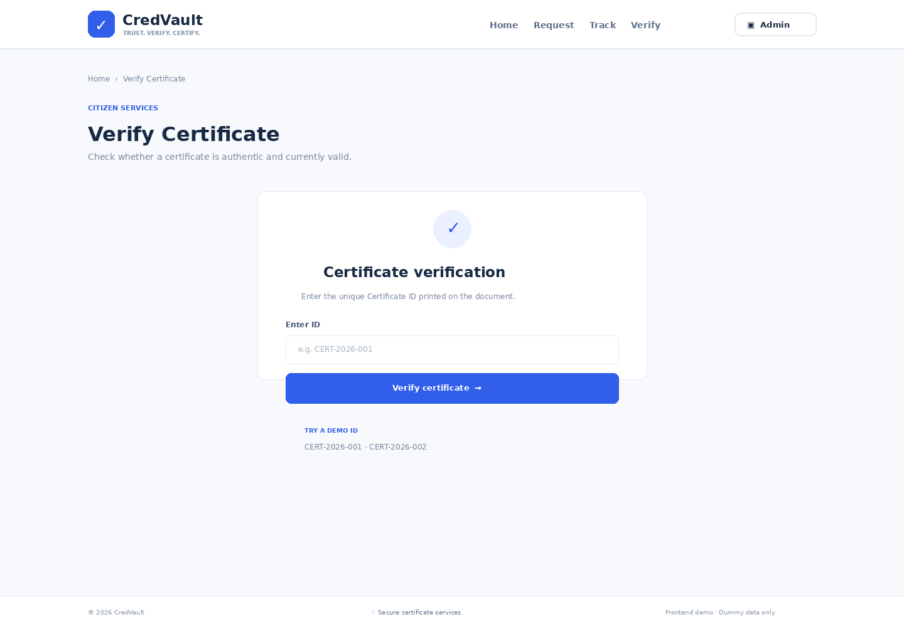
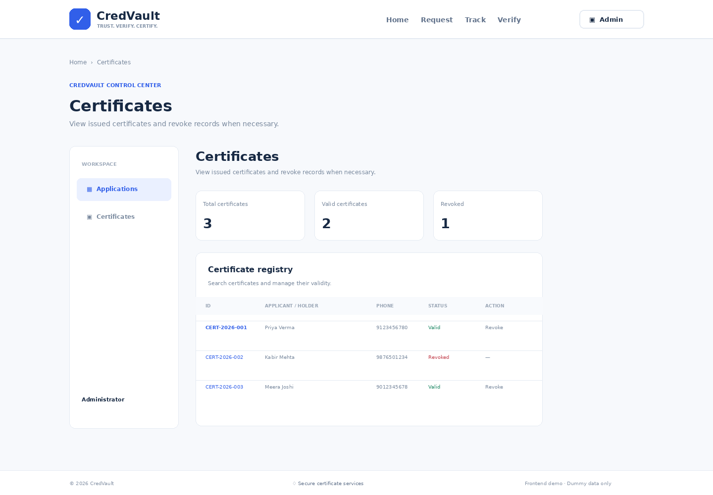

# CredVault — ELEVATE SDE Task 4

**Full Stack Development: Frontend & Backend Integration**

This repository combines the CredVault frontend from Task 2 with the API and SQLite database from Task 3, then connects the citizen and admin workflows to real backend records. It follows the uploaded Task 4 SRS: citizen requests, tracking, certificate verification, admin login, protected application management, certificate issuance and revocation.

## Technology

- **Frontend:** React 18, Vite, React Router, Lucide React
- **Backend:** Node.js 20+, Express
- **Database:** SQLite (`better-sqlite3`)
- **Authentication:** bcrypt password hashes and JWT bearer tokens
- **Validation/security:** Zod, Helmet, CORS allow-list, request size limit, rate limiting

## Project structure

```text
ELEVATE-SDE-Task-4/
├── frontend/              # React/Vite UI connected to the API
│   ├── src/App.jsx
│   ├── src/styles.css
│   └── .env.example
├── backend/               # Express REST API and SQLite persistence
│   ├── src/routes/
│   ├── src/db/database.js
│   ├── scripts/seed-admin.js
│   └── .env.example
├── package.json           # npm workspaces and combined dev command
└── README.md
```

## Requirements

- Node.js 20 or newer
- npm
- Internet connection for the first dependency installation

## Run both frontend and backend

From the repository root:

```bash
npm install
```

Create environment files:

**Windows PowerShell**
```powershell
Copy-Item backend/.env.example backend/.env
Copy-Item frontend/.env.example frontend/.env
```

**macOS/Linux**
```bash
cp backend/.env.example backend/.env
cp frontend/.env.example frontend/.env
```

For local demo use, the backend `.env` sample has username `admin` and password `admin`. Run the seed command once to store a bcrypt password hash:

```bash
npm run db:seed --workspace backend
```

Then start both services in one terminal:

```bash
npm run dev
```

- Frontend: `http://localhost:5173`
- Backend API: `http://localhost:4000`
- Health check: `http://localhost:4000/api/health`

Alternatively run each service separately in its own terminal:

```bash
npm run dev --workspace backend
npm run dev --workspace frontend
```

SQLite automatically creates `backend/data/credvault.sqlite` based on the backend environment file. The database and `.env` files are excluded from Git.

## End-to-end flow

1. Open **Request Certificate**, submit the form, and receive the real Application ID from the API.
2. Open **Track Application** and enter that ID. Status and submission time are read from SQLite.
3. Open **Admin Login** and sign in with the seeded backend account.
4. On **Applications**, review records from the database. Approve an application to generate a real Certificate ID, or reject a pending application.
5. On **Certificates**, view issued certificate records and revoke a valid certificate.
6. On **Verify Certificate**, enter the Certificate ID. The response reflects the live status, including `Revoked`.

No seeded sample application/certificate records are used in the frontend. Empty lists are expected until you submit a request and approve it.

## API endpoints

| Method | Endpoint | Access | Description |
|---|---|---|---|
| GET | `/api/health` | Public | Health check |
| POST | `/api/applications` | Public | Submit request |
| GET | `/api/applications/track/:applicationId` | Public | Track application |
| GET | `/api/certificates/verify/:certificateId` | Public | Verify certificate |
| POST | `/api/admin/login` | Public | Get JWT |
| GET | `/api/admin/me` | Admin JWT | Validate admin session |
| GET | `/api/admin/applications` | Admin JWT | List applications (Task 4 SRS route) |
| PATCH | `/api/admin/applications/:applicationId/approve` | Admin JWT | Approve and issue certificate |
| PATCH | `/api/admin/applications/:applicationId/reject` | Admin JWT | Reject application |
| GET | `/api/admin/certificates` | Admin JWT | List certificates (Task 4 SRS route) |
| GET | `/api/admin/certificates/:certificateId/revoke` | Admin JWT | Revoke certificate (matches SRS) |
| PATCH | `/api/admin/certificates/:certificateId/revoke` | Admin JWT | Conventional alternative |

The backend also retains the Task 3 endpoints under `/api/applications` and `/api/certificates`. Admin-prefixed aliases are protected by JWT authentication.

## Environment configuration

`backend/.env`:
- `PORT`: API port, default 4000
- `DATABASE_FILE`: SQLite path, default `./data/credvault.sqlite`
- `JWT_SECRET`: replace the local sample with a unique random secret of at least 32 characters before deployment
- `JWT_EXPIRES_IN`: token lifetime, default `2h`
- `ADMIN_USERNAME` / `ADMIN_PASSWORD`: used by the seed script
- `CORS_ORIGIN`: allowed frontend origin, default `http://localhost:5173`

`frontend/.env`:
- `VITE_API_BASE_URL=http://localhost:4000/api`

## Tests and build

```bash
npm test
npm run build
```

The tests cover ID formatting and utility behavior. The production frontend build checks the Vite bundle. Run these commands locally after `npm install`.

## Security and deployment notes

- The `admin/admin` account is only a local demonstration account. Change it before deployment.
- Use a strong `JWT_SECRET`, HTTPS, and an exact trusted `CORS_ORIGIN` in production.
- Never commit `.env`, database files, or real personal data.
- This internship project is not a security-audited production service.
- The frontend requires the API to be running. If requests fail, check the API health endpoint, `.env` values, and browser console.

## UI reference previews

The following images were carried over from the Task 2 UI draft. They are **visual reference previews, not verified screenshots of the integrated Task 4 application**. The Task 4 SRS asks for screenshots or a screen recording of the entire working website, so replace these with fresh captures after running and testing both services.

### Home page preview


### Request certificate page preview


### Track application page preview


### Verify certificate page preview


### Admin login page preview


### Admin applications page preview


### Admin certificates page preview


## Submission checklist

- [ ] Repository is named `ELEVATE-SDE-Task-4`
- [ ] `npm install` succeeds
- [ ] `npm run db:seed --workspace backend` succeeds
- [ ] Both services run with `npm run dev`
- [ ] Submit a request and confirm the Application ID comes from the API
- [ ] Track the new Application ID
- [ ] Log in, approve/reject applications, and revoke a certificate
- [ ] Verify both valid and revoked certificate statuses
- [ ] Capture actual screenshots or a screen recording of the running website and add them to this README before submission

## GitHub

Create a repository named **`ELEVATE-SDE-Task-4`**, then run from this folder:

```bash
git init
git add .
git commit -m "Integrate CredVault frontend with backend APIs"
git branch -M main
git remote add origin https://github.com/YOUR-USERNAME/ELEVATE-SDE-Task-4.git
git push -u origin main
```

Replace `YOUR-USERNAME` with your GitHub username.
